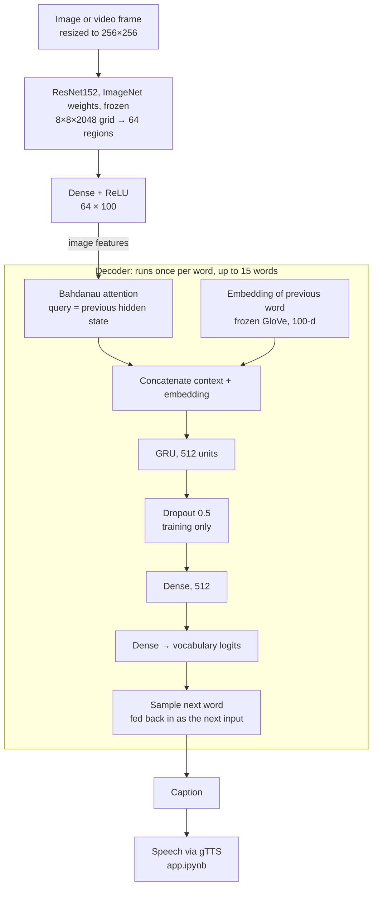
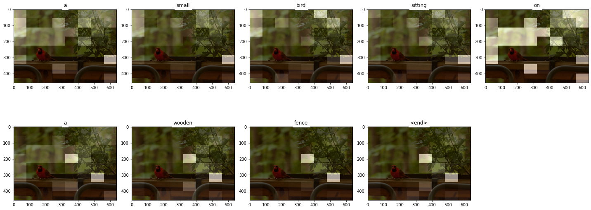
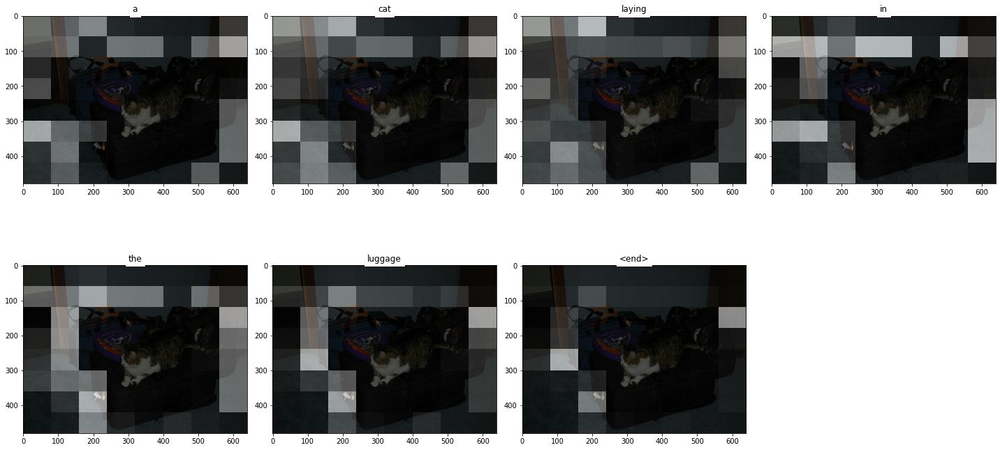

# unlimited-vision

Writes a one-sentence caption for an image or video frame and reads it aloud.

The captioning model follows the CNN + attention + GRU design from [*Show, Attend and Tell*](https://arxiv.org/abs/1502.03044) (Xu et al., 2015).

## Features

- **Image encoder:** ResNet152 with ImageNet weights, on 256×256 images.
- **Word embeddings:** frozen 100-d GloVe vectors, fine-tuned on the COCO training captions with [Mittens](https://github.com/roamanalytics/mittens) (`glove.ipynb`).
- **Dropout** (0.5) after the GRU.
- **Data and scoring:** trains on all 118k COCO 2017 training images (5 captions each) and scores on the 5,000 val2017 images with the standard COCO caption metrics.
- **Video app** (`app.ipynb`): plays a video, captions every 60th frame and speaks the caption with gTTS.

## Architecture



- ResNet152 is never trained. `initialize.py` runs it once over every image and caches the features as `.npy` files, and training reads those files.
- Attention runs inside the decoder at every step, using the hidden state from the previous step as its query.
- Each word is sampled from the predicted distribution (`tf.random.categorical`), not picked with greedy or beam search, so the same image can get different captions.

## Results

Scored on all 5,000 COCO val2017 images with [pycocoevalcap](https://github.com/salaniz/pycocoevalcap), one sampled caption per image. Scores are multiplied by 100, as in papers.

| Run | BLEU-1 | BLEU-4 | METEOR | ROUGE-L | CIDEr | SPICE |
|---|---|---|---|---|---|---|
| 81 epochs (2022-05-21) | 48.4 | 9.6 | – | – | – | – |
| 51 epochs, 224×240 input, 30-word limit (2022-05-08) | 47.3 | 9.0 | 15.4 | 34.5 | 33.2 | 9.9 |

Both runs predate the dropout layer. The current code hasn't been scored on the full validation set.

Example outputs, showing where the model attends on the 8×8 grid for each word:

<div>

</div>

<div>

</div>

## Setup

You need Windows, Python 3.9, a TensorFlow 2.x release older than 2.16 (the code predates Keras 3), and Java, which pycocoevalcap needs to compute the scores.

1. Create the environment. The `.bat` scripts expect it to be named `uvapp`.

   ```
   conda create -n uvapp python=3.9
   conda activate uvapp
   pip install "tensorflow>=2.7,<2.16" numpy pillow matplotlib scikit-learn tqdm nltk mittens opencv-python gTTS playsound==1.2.2 pycocotools pycocoevalcap
   ```

   `requirements.txt` is a conda export of the original environment, and `pip install -r` won't accept it.

2. Download the [COCO 2017](https://cocodataset.org/#download) train and val images with their caption annotations, and [GloVe 6B](https://nlp.stanford.edu/projects/glove/). Arrange them like this, and create the empty folders yourself:

   ```
   dataset/
     coco/
       tarin/                    # spelled "tarin" in the code
         captions_train2017.json
         images/                 # train2017 images
       val/
         captions_val2017.json
         val2017/                # val2017 images
       result/                   # empty; evaluation writes JSON here
     glove.6B/
       glove.6B.100d.txt
   checkpoints/
     dataset/                    # empty; initialize.py writes here
   testVideos/                   # videos for app.ipynb
   TestSamples/                  # empty; app.ipynb writes MP3s here
   ```

3. Run these in order:
   1. `glove.ipynb` fine-tunes GloVe on the training captions and writes `dataset/glove.6B/new_glove.6B.100d.pkl`.
   2. `initialize.bat` (or `python initialize.py`) caches the ResNet152 features next to each image and saves the tokenized captions and vocabulary to `checkpoints/dataset/`.
   3. `train.bat` (or `python train.py`) saves a checkpoint to `checkpoints/train/` after every epoch and prints COCO scores every 10 epochs. `epochs` is set to 3000 and early stopping is off, so stop it yourself.
   4. `evaluation.ipynb` plots the loss, computes the COCO scores and draws attention maps.
   5. `app.ipynb` captions a video. Set `PATH` to a file in `testVideos/`. Press `e` to skip the 5-second pause after each caption, or `q` to quit.

## Credits

- **Architecture:** Xu et al., [*Show, Attend and Tell*](https://arxiv.org/abs/1502.03044) (2015). Attention from Bahdanau et al., [*Neural Machine Translation by Jointly Learning to Align and Translate*](https://arxiv.org/abs/1409.0473) (2014).
- **GloVe embedding matrix:** adapted from the Keras example [Using pre-trained word embeddings](https://keras.io/examples/nlp/pretrained_word_embeddings/), Apache License 2.0.
- **GloVe fine-tuning:** adapted from [chmodsss's Mittens gist](https://gist.github.com/chmodsss/867e01cc3eeeaa42226ac931709077dc) and the article [Fine-tune GloVe embeddings using Mittens](https://towardsdatascience.com/fine-tune-glove-embeddings-using-mittens-89b5f3fe4c39).
- **Embeddings and tools:** [GloVe](https://nlp.stanford.edu/projects/glove/) (Pennington et al., 2014) and [Mittens](https://github.com/roamanalytics/mittens) (Dingwall and Potts, 2018).
- **Data and metrics:** [COCO](https://cocodataset.org/) and [pycocoevalcap](https://github.com/salaniz/pycocoevalcap).
